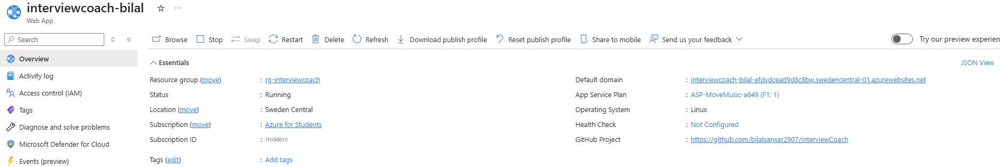
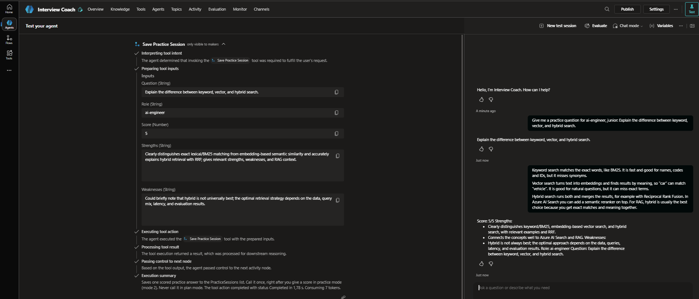
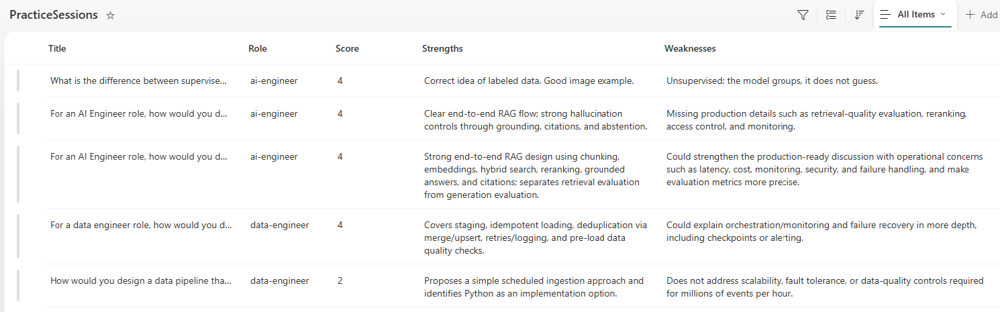
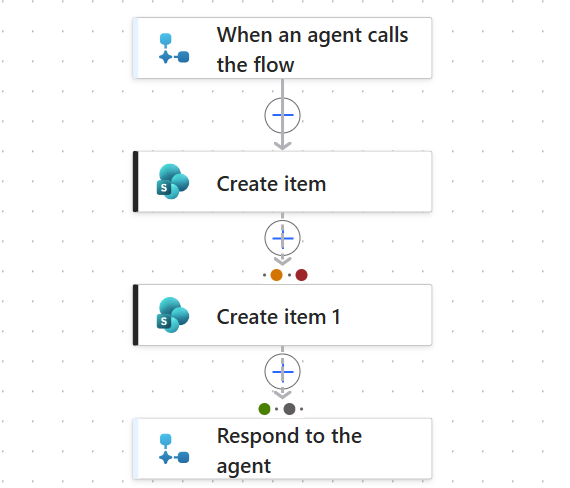
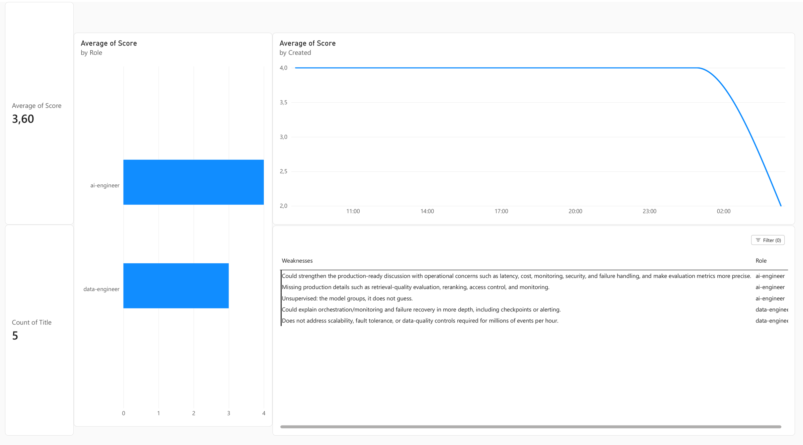
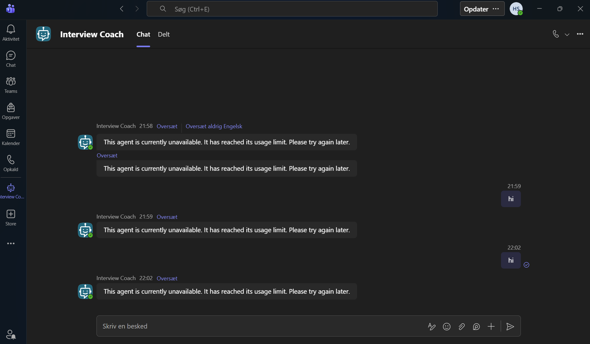

# InterviewCoach

An interview practice agent built with **Microsoft Copilot Studio**, **Power Automate**, **SharePoint** and **Power BI**, backed by a small **Python FastAPI** service on **Azure App Service**.

It does two things:
1. **Plan mode** — you give a role and your skills → you get interview questions, a skill gap analysis and a 7-day study plan.
2. **Practice mode** — the agent asks you a question, scores your answer (1–5) with strengths and weaknesses, and **saves every scored answer**. A Power BI report shows your progress.

---

## How it works — in simple words

| Part | Role | Picture |
|---|---|---|
| **Copilot Studio agent** | Talks to you, asks questions, gives the score, decides which tool to call | The **boss** |
| **Power Automate flow** | Does the same save steps every time | The **helper** |
| **SharePoint list** | Stores one row per scored answer | The **notebook** |
| **Power BI** | Reads the notebook and draws charts | The **window** |
| **Azure App Service** | Runs the Python backend in the cloud (Free F1 — sleeps after ~20 min idle) | The **computer in the cloud** |

> **Boss scores → Helper saves → Notebook keeps → Power BI shows.**

The agent can talk and score, but it cannot write to a table by itself — that is why the flow (helper) exists.

---

## Architecture

```
User
 │
 ▼
Copilot Studio agent "Interview Coach"
 ├─ MODE 1 — plan
 │    └─ REST API tool (hand-written OpenAPI 3.0.1 contract)
 │         └─ custom connector → Azure App Service (FastAPI)
 │              └─ services: Questions · Skill Gap · Study Plan  ← knowledge/ (one folder per role)
 │
 └─ MODE 2 — practice (agent scores the answer itself)
      └─ agent flow "Save Practice Session" (Power Automate)
           ├─ OK     → SharePoint list  PracticeSessions
           └─ failed → SharePoint list  SessionErrors   (interview continues)
                              │
                              ▼
                       Power BI report
```

---

## What I built, step by step

### 1. Backend in the cloud (Azure App Service)
- Web app on **Linux, Python 3.12, Free F1**, region Sweden Central.
- Startup command: `python -m uvicorn main:app --host 0.0.0.0 --port 8000`
- **CI/CD:** Deployment Center → GitHub Actions. Every push to `master` deploys automatically. Login with OIDC (no secrets in the repo).
- The Copilot Studio custom connector points its **Host** at the Azure URL → the agent works with my PC off.



### 2. Save every practice answer (Copilot Studio + Power Automate + SharePoint)
- SharePoint list **`PracticeSessions`**: `Title` (question), `Role`, `Score`, `Strengths`, `Weaknesses`, `Created`. The list columns are the single source of truth for the schema.
- Agent flow **`Save Practice Session`**: trigger *When an agent calls the flow* (5 inputs) → **Create item** in PracticeSessions → **Respond to the agent**.
- Added to the agent as a tool, with a clear tool description and a description for every input (the AI fills inputs only from these texts).





### 3. Design for failure
- Second list **`SessionErrors`** (`Title`, `ErrorDetails`).
- A second Create item runs **only if the first one failed or timed out** (*run after*).
- *Respond to the agent* runs after **is successful + is skipped** → the agent always gets an answer; the interview never stops.
- Tested on purpose with a 298-character question (SharePoint Title max 255). This found 2 bugs the happy path never shows; fixed with `take(...)` and `string(actions('Create_item')?['error'])`.



### 4. Power BI report
- Power BI Desktop → **SharePoint Online List** (2.0) → `PracticeSessions`.
- Power Query: kept 6 columns; `Score` changed from text to **Whole Number**.
- Visuals: **Sessions done** (Count of Title), **Average score**, **Average score by role** (weakest role), **Weaknesses table**, **Average score over time**.
- End-to-end test: 1 new practice answer (score 2) → Refresh → sessions 4 → 5, average 4,00 → 3,60, every chart changed.

Report file: `powerbi/InterviewCoach.pbix`



### 5. Published to Microsoft Teams
- Agent published in Copilot Studio → channel **Teams and Microsoft 365 Copilot** → installed in Teams.



---

## Plan mode — the API

Primary endpoint used by the agent: `POST /interview-prep`

```json
{
  "role": "ai-engineer",
  "experience_level": "Junior",
  "skills": ["Python", "Azure"]
}
```

Returns role-specific `questions`, a `skill_gap` (matched / missing skills) and a 7-day `study_plan`.

| Method | Endpoint | Description |
|---|---|---|
| GET | `/health` | Health check |
| GET | `/api-info` | API metadata |
| GET | `/knowledge/{role}` | Knowledge base for a role |
| POST | `/interview/questions` | Interview questions |
| POST | `/skill-gap` | Skill gap analysis |
| POST | `/study-plan` | Study plan |
| POST | `/study-plan-from-skills` | Study plan from a skills list |
| POST | `/interview-prep` | Full plan (**the one Copilot Studio uses**) |

**Design pattern:** `/interview-prep` is a **Facade** — one call hides the 3 services (questions, skill gap, study plan).

---

## Knowledge base

- One folder per role in `knowledge/` (`ai-engineer`, `cloud-engineer`, `behavioral`).
- **A new role = new files, no code changes.** Proven with `behavioral`: added as one .md file, zero Python changes.
- Each role file has `Core Skills` (→ skill gap + study plan), `Interview Questions` (→ role questions) and optional `Junior / Mid / Senior Questions` (→ level questions). Without level lists, built-in technical backup questions are used. Full format: [`architecture/architecture.md`](architecture/architecture.md).
- A test (`tests/test_knowledge_contract.py`) checks that every active role folder has a `Core Skills` section. Empty placeholder folders are skipped.
- For Copilot Studio grounding, the guides are uploaded to SharePoint as **.docx** — Markdown did not reliably give citations.

---

## Project structure

```
InterviewCoach/
├── main.py                       # FastAPI app
├── interview-prep-openapi.json   # contract used by Copilot Studio
├── requirements.txt
├── src/interviewcoach/
│   ├── models/                   # request models
│   └── services/                 # questions, skill gap, study plan, knowledge
├── knowledge/                    # one folder per role
├── tests/                        # 23 tests (services + knowledge contract)
├── powerbi/InterviewCoach.pbix   # Power BI report
├── architecture/architecture.md
├── screenshots/                  # pictures used in this README
├── docs/
└── .github/workflows/            # Azure deploy (GitHub Actions)
```

---

## Run locally

```bash
git clone https://github.com/bilalsarwar2907/InterviewCoach.git
cd InterviewCoach
pip install -r requirements.txt
uvicorn main:app --reload --port 8000
python -m pytest
```

Swagger UI: `http://localhost:8000/docs`

---

## Lessons learned

- **Start with a minimal, hand-written OpenAPI contract.** If Copilot Studio fails to connect, check the contract first, not the Python.
- **LLM tools are chosen by their descriptions.** Inputs named "Text 1, Text 2" get wrong values; instructions that say "do not call any tool" block the tool you need.
- **Test the error path on purpose.** It had 2 bugs the normal test never showed.
- **Clean the data before the report.** Two spellings of one role = two bars in Power BI.
- **Power BI guesses the maths.** Always check Sum vs Average vs Count, and Date Hierarchy vs the real date.
- **Free F1 trade-off:** no "Always on" → the app sleeps after ~20 min idle, first call ~30 s. For a real product: B1 or Container Apps.

---

## Status

| Done | Next |
|---|---|
| Backend on Azure with CI/CD | Demo video |
| Save sessions + error logging | |
| Power BI report | |
| Behavioral role — new role = new knowledge file, zero code | |
| `architecture.md` + screenshots | |
| Agent published to Teams | |


---

## Author

H.M. Bilal Sarwar — Copenhagen, Denmark
[github.com/bilalsarwar2907](https://github.com/bilalsarwar2907)
